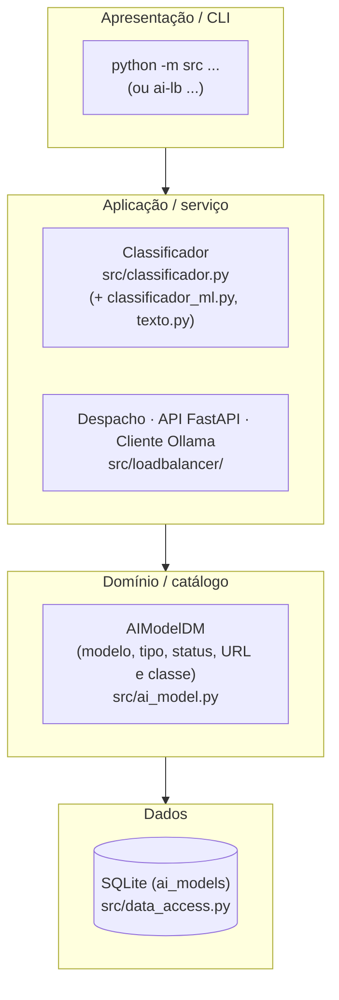
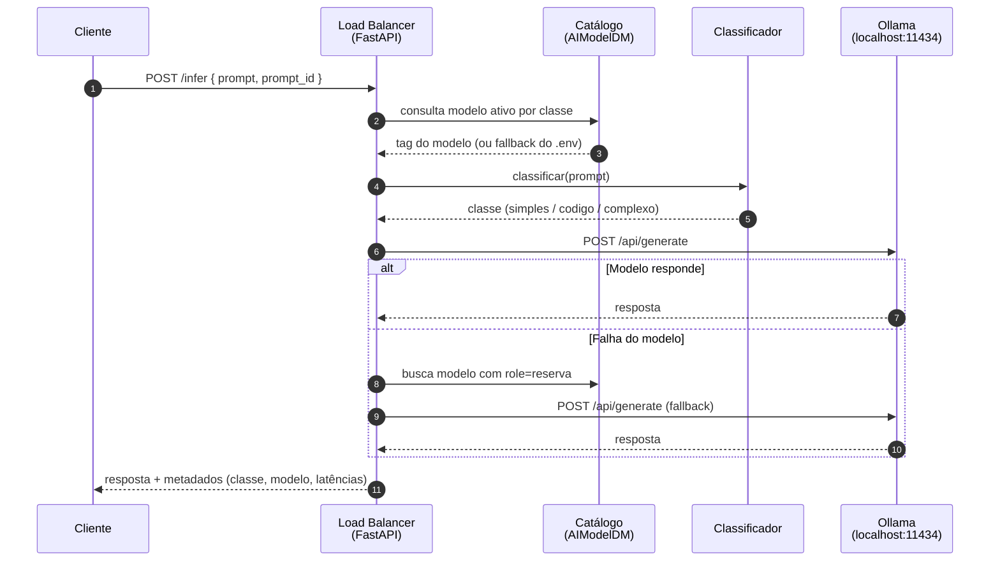

# TI5 — Load Balancer para Modelos de IA

Roteamento de requisições por complexidade entre modelos de IA de diferentes portes, servidos via [Ollama](https://ollama.com/). O projeto reúne, em uma única CLI, o catálogo de modelos, o classificador de prompts, o serviço de balanceamento e os experimentos.

**Integrantes:**
- Artur Fernandes Braga de Menezes
- Artur Rizzi Martinho
- Felipe Lacerda Tertuliano
- Gabriel Alves da Silva Diógenes
- Rafael Mortimer Colares

**Instituição:** Pontifícia Universidade Católica de Minas Gerais (PUC Minas)
**Disciplina:** Trabalho Interdisciplinar V
**Sprint atual:** Sprint 2 (semana 3)

---

## 📖 Sobre o projeto

Sistemas de IA em produção costumam enviar **toda** requisição — simples ou complexa — para o **mesmo modelo de grande porte**. Isso gera uso ineficiente de GPU/CPU em tarefas triviais, maior latência e maior custo de inferência.

Este projeto propõe um **Load Balancer** que:

1. **Mantém um catálogo** de modelos locais e remotos, com a classe que cada um atende;
2. **Classifica** cada prompt pela complexidade (regras, modelo treinado ou híbrido, com tamanho medido em tokens);
3. **Encaminha** para o modelo mais adequado entre os registrados:
   - `AILO-152M-v2` → prompts **simples** (curtos, factuais)
   - `Qwen2.5-Coder-0.5B` → prompts de **código**
   - `Phi-3.5-mini` → prompts **complexos** (longos ou de raciocínio)
4. **Mede** latência e registra cada decisão;
5. **Executa e analisa** os experimentos baseline × proposta.

**Lacuna explorada:** os trabalhos relacionados (SAL, Llumnix, SkyWalker, DualMap) balanceiam **réplicas do mesmo modelo**. Nenhum classifica a complexidade do prompt para escolher entre **modelos de portes diferentes**.

---

## 🏗️ Arquitetura em camadas

O código segue uma separação simples em camadas, com uma única porta de entrada:



O **load balancer consulta o catálogo** (`AIModelDM`) para descobrir qual tag atende cada classe. Se uma classe ainda não tiver modelo ativo no banco, ele usa a tag correspondente do `.env` como fallback.



### Estrutura de pastas

```
.
├── article/                 # Artigo SBC (.tex, .pdf)
├── docs/                    # Cronograma e seções auxiliares
├── presentation/            # Slides
├── experiments/             # Scripts e dados do experimento
│   ├── rodar_experimento.py      # baseline x proposta (sequencial ou --concorrencia N)
│   ├── analisar.py
│   ├── gerar_prompts.py          # gera o conjunto rotulado com um LLM
│   ├── treinar_classificador.py  # treina o classificador ML
│   ├── avaliar_classificador.py  # regras x ML x híbrido (x LLM)
│   ├── prompts.json              # 40 prompts escritos à mão
│   ├── prompts_gerados.json      # conjunto gerado (treino/teste)
│   ├── prompts_experimento.json  # 40 manuais + subconjunto estratificado do teste
│   ├── dados/                    # respostas brutas do gerador (retomável)
│   └── executar_rodada.sh
├── modelos/                 # classificador treinado (.joblib + metadados .json)
├── src/
│   ├── __main__.py          # `python -m src`
│   ├── cli.py               # CLI unificada (models, serve, infer, ...)
│   ├── ai_model.py          # Catálogo de modelos (camada de domínio)
│   ├── data_access.py       # SQLite (camada de dados)
│   ├── classificador.py     # Estratégias regras / ml / hibrido
│   ├── classificador_ml.py  # TF-IDF ou embeddings + Regressão Logística
│   ├── texto.py             # Normalização e contagem de tokens
│   ├── log.py               # Logging colorido
│   └── loadbalancer/
│       ├── api.py           # Endpoints FastAPI
│       ├── dispatcher.py    # Classifica + despacha + fallback
│       ├── ollama_client.py # Cliente httpx do Ollama
│       ├── registry.py      # Ponte catálogo ↔ load balancer
│       ├── schemas.py       # Contratos (dataclasses)
│       └── settings.py      # Configuração via .env
├── tests/
│   ├── test_cli.py
│   ├── test_classificador.py
│   ├── test_classificador_ml.py
│   ├── test_experimentos.py
│   ├── test_loadbalancer.py
│   ├── test_loadbalancer_integracao.py
│   └── test_loadbalancer_ollama_real.py
├── .env.example
├── pyproject.toml
├── requirements.txt
└── README.md
```

---

## ⚙️ Pré-requisitos

- **Python** 3.11 ou superior
- **Ollama** instalado e rodando ([download](https://ollama.com/download))
- Os **três modelos** disponíveis no Ollama:
  ```bash
  ollama pull Alieno/ailo-152m-v2
  ollama pull qwen2.5-coder:0.5b
  ollama pull phi3.5
  ```
- **~4 GB de RAM livre** (para os três modelos pequenos)

> 💡 Confira os nomes das tags com `ollama list`. Eles precisam bater com o que for registrado na CLI.

---

## 🚀 Instalação

### 1. Clonar o repositório

```bash
git clone https://github.com/arturmartinho/Trabalho-Interdiciplinar-5.git
cd Trabalho-Interdiciplinar-5
```

### 2. Criar e ativar o ambiente virtual

```bash
python -m venv .venv
```

**Windows:**
```bash
.venv\Scripts\activate
```

**Linux / macOS:**
```bash
source .venv/bin/activate
```

> Em alguns sistemas, use `python3` em vez de `python`.

### 3. Instalar as dependências

```bash
pip install -e ".[dev]"
```

Para o classificador treinado e a contagem de tokens (`scikit-learn`, `tokenizers`) e para os experimentos (gráficos e métricas de RAM), instale também os extras:

```bash
pip install -e ".[dev,ml,experiments]"
```

Sem o extra `ml`, o balancer continua funcionando com as regras e uma estimativa de tokens.

Alternativa sem instalação editável:

```bash
pip install -r requirements.txt
pip install -r requirements-experiments.txt
```

### 4. Configurar o `.env`

```bash
cp .env.example .env
```

Edite o `.env` conforme sua máquina. Os valores padrão já funcionam para uso local com Ollama.

### 5. Subir o Ollama

Em um terminal separado:

```bash
ollama serve
```

---

## 🖥️ CLI unificada

Tudo é acessível por `python -m src <comando>` (ou pelo atalho `ai-lb <comando>` depois de `pip install -e .`).

```bash
python -m src --help
python -m src models --help
```

| Comando | O que faz |
|---|---|
| `models list` | Lista os modelos registrados |
| `models register` | Registra um modelo manualmente (sem testar a conexão) |
| `models host` | Baixa/instala e sobe um modelo local no Ollama |
| `models connect` | Conecta a um modelo remoto e valida a URL |
| `models update` | Atualiza o status (ping) de um modelo ou de todos |
| `models stop` / `models resume` | Descarrega / recarrega um modelo local |
| `models call` | Envia um prompt direto a um modelo do catálogo |
| `models remove` | Remove um modelo do catálogo |
| `classify` | Mostra a classe, o modelo, os tokens e o motivo para um prompt (`--estrategia`) |
| `infer` | Executa uma inferência pelo load balancer |
| `serve` | Sobe a API HTTP do load balancer |
| `experiment` | Roda baseline + proposta e grava `resultados.csv` |
| `analyze` | Gera métricas, gráficos e relatório a partir do CSV |
| `generate-prompts` | Gera o conjunto de prompts rotulados com um LLM do Ollama |
| `train-classifier` | Treina o classificador ML a partir do conjunto gerado |
| `eval-classifier` | Compara regras × ML × híbrido (× LLM) em acurácia e tempo |

### Registrar os três modelos

A classe (`--role`) é o que liga cada modelo ao roteamento. Use `simples`, `codigo`, `complexo` e `reserva` (fallback).

```bash
# Modelos locais já baixados: registra o status como "up"
python -m src models register --name Alieno/ailo-152m-v2 --type local --role simples  --status up
python -m src models register --name qwen2.5-coder:0.5b  --type local --role codigo   --status up
python -m src models register --name phi3.5              --type local --role complexo --status up
python -m src models register --name phi3.5              --type local --role reserva  --status up
```

Se preferir que a CLI instale/baixe e suba o modelo no Ollama:

```bash
python -m src models host --name phi3.5 --role complexo
```

Para apontar para uma instância remota:

```bash
python -m src models connect --name phi3.5 --url http://192.168.0.10:11434 --role complexo
```

> **Precedência do roteamento:** modelo ativo no catálogo (`status=up`) para a classe → tag `MODELO_*` do `.env`. O fallback usa o modelo com `role=reserva`; se não houver, usa `FALLBACK_MODEL`.
>
> O catálogo também define o **endereço do backend**: um modelo registrado com `--url` é chamado nessa URL, e os modelos locais usam `OLLAMA_HOST`. Assim, `models connect` não serve apenas para listar — o load balancer despacha de fato para o nó remoto.
>
> O classificador resolve o catálogo na primeira requisição. Depois de registrar ou trocar um modelo, reinicie `python -m src serve`.

### Subir o load balancer

```bash
python -m src serve
# ou: python -m src serve --host 0.0.0.0 --port 8000
```

O serviço sobe em `http://127.0.0.1:8000`. Confira:

```bash
curl http://127.0.0.1:8000/health
```

> O alias legado `python -m src.loadbalancer` continua funcionando.

### Testar uma inferência pela CLI

Modo direto (não exige o `serve`; usa o mesmo despacho internamente):

```bash
python -m src infer --prompt "Qual é a capital da França?" --prompt-id teste-1
```

Contra um load balancer já em execução:

```bash
python -m src infer --url http://127.0.0.1:8000 --prompt "Escreva uma função em Python"
```

Use `--json` para ver classe, modelo escolhido, modelo que atendeu, redirecionamento e latências.

### Classificar sem executar o modelo

```bash
python -m src classify --prompt "Explique passo a passo por que o céu é azul." --json
python -m src classify --prompt "como ordeno uma lista pela idade?" --estrategia hibrido
```

### Rodar os testes

```bash
pytest
```

Para rodar apenas os testes que **não precisam** do Ollama:

```bash
pytest tests/test_classificador.py tests/test_loadbalancer.py tests/test_cli.py
```

Os testes de integração (`test_loadbalancer_integracao.py` e `test_loadbalancer_ollama_real.py`) sobem a API de verdade. O segundo é pulado automaticamente se o Ollama local não tiver os três modelos.

---

## 📡 API do Load Balancer

### `GET /health`

Verifica se o serviço está pronto (Ollama acessível + modelos esperados presentes).

**Resposta 200** (ok):
```json
{
  "ok": true,
  "ollama_host": "http://127.0.0.1:11434",
  "fallback_model": "phi3.5",
  "expected_models": ["Alieno/ailo-152m-v2", "qwen2.5-coder:0.5b", "phi3.5"],
  "models": ["Alieno/ailo-152m-v2", "qwen2.5-coder:0.5b", "phi3.5"],
  "registered_models": [
    {"id": 1, "name": "phi3.5", "type": "local", "status": "up", "role": "complexo", "url": ""}
  ],
  "missing_models": [],
  "error": null
}
```

**Resposta 503** (Ollama offline ou modelo esperado ausente):
```json
{ "ok": false, "error": "..." }
```

### `POST /infer`

Recebe um prompt, classifica e encaminha.

**Request:**
```json
{
  "prompt": "Qual é a capital da França?",
  "prompt_id": "s01"
}
```

**Resposta 200:**
```json
{
  "request_id": "a1b2c3d4e5f6",
  "prompt_id": "s01",
  "response": "Paris",
  "label": "simples",
  "reason": "pedido curto (5 palavras <= 25) sem sinais de codigo/raciocinio",
  "chosen_model": "Alieno/ailo-152m-v2",
  "served_model": "Alieno/ailo-152m-v2",
  "redirected": false,
  "redirect_reason": null,
  "attempt_latency_s": 0.312,
  "ollama_latency_s": 0.312,
  "e2e_latency_s": 0.320,
  "ok": true,
  "error": null
}
```

### `POST /v1/chat/completions`

Compatível com o formato OpenAI (simplificado). O campo `model` é **ignorado** — quem decide é o classificador.

```json
{
  "messages": [
    {"role": "user", "content": "Escreva uma função em Python"}
  ]
}
```

---

## 🧠 Classificador de prompts

Arquivos: `src/classificador.py` (estratégias), `src/classificador_ml.py` (modelo treinado) e `src/texto.py` (tokens). A estratégia vem de `CLASSIFICADOR` no `.env` (`regras`, `ml` ou `hibrido`) ou de `--estrategia` no `classify`.

### Tamanho em tokens

O tamanho do prompt é medido em **tokens do Phi-3.5** (`TOKENIZADOR=microsoft/Phi-3.5-mini-instruct`), não em palavras. O custo para o modelo (prefill, limite de contexto) cresce com tokens, e a razão palavras/tokens muda entre idiomas e entre texto e código. O tokenizador é baixado do Hugging Face uma vez e depois lido do cache. Sem rede ou sem o pacote `tokenizers`, vale uma estimativa por caracteres (~0,34 token/caractere, calibrada nos 40 prompts manuais). Os limites antigos de 25 e 120 palavras viraram **50 e 240 tokens** (~2 tokens por palavra em português).

### Estratégia `regras`

Regras determinísticas (a primeira que casar decide):

| # | Condição | Classe | Modelo padrão |
|---|----------|--------|---------------|
| 1 | Prompt vazio | `simples` | AILO |
| 2 | Mais de **240 tokens** | `complexo` | Phi |
| 3 | Sinal de **código** | `codigo` | Qwen |
| 4 | Sinal de **raciocínio** | `complexo` | Phi |
| 5 | Até **50 tokens**, sem sinais | `simples` | AILO |
| 6 | Demais casos (ambíguo) | `complexo` | Phi |

- Código + raciocínio → **código tem prioridade** (o modelo especializado conhece melhor o domínio).
- Tamanho médio sem sinais → **Phi** (errar para o maior aumenta latência, mas não compromete a resposta).

### Estratégia `ml`

Regressão Logística sobre:
- **`tfidf`** (padrão): TF-IDF de palavras + n-gramas de caracteres (pegam a sintaxe de código: `{`, `;`, `()`). Classifica em cerca de 1 ms, sem rede e sem RAM extra no Ollama. Não usa o tamanho do prompt como feature: nos dados gerados quase todo pedido complexo é longo, e com essa feature o modelo aprendia "curto = simples" (nos 40 manuais: 95% com, 97,5% sem).
- **`embed`**: embeddings de frase do Ollama (`/api/embed`, padrão `paraphrase-multilingual`) + log dos tokens. Lida melhor com paráfrases, mas faz uma chamada HTTP por prompt e ocupa mais um modelo em memória. No balancer, essa chamada roda fora do event loop.

O modelo é treinado com `python -m src train-classifier` e salvo em `modelos/classificador_<features>.joblib`, com metadados em `.json`. O C é escolhido por validação cruzada.

### Estratégia `hibrido` (recomendada)

1. Sintaxe de código de fato (bloco ```` ``` ````, `def f(`, `import x`, `SELECT … FROM … WHERE`, `Traceback`, `;` no fim da linha…) → `codigo`, sem consultar o modelo.
2. Caso contrário, decide o modelo treinado. Se a confiança dele ficar abaixo de `CLASSIFICADOR_LIMIAR` (0,55), valem as regras.
3. Um prompt com mais de 240 tokens nunca vai para o modelo `simples` (limite de contexto do AILO).
4. Se o modelo disser `simples` mas houver sinal explícito de raciocínio ("prove", "passo a passo", "por que", "compare"…), vale `complexo`. O modelo treinado tende a achar que todo pedido curto é simples, e mandar para o modelo menor é o erro caro: compromete a resposta. Mandar para o maior só custa latência.

Se o modelo treinado não existir ou o `scikit-learn` não estiver instalado, `ml` e `hibrido` usam as regras e dizem isso no `motivo`. O `GET /health` mostra a estratégia, o tokenizador e o modelo carregado (campo `classifier`).

O parâmetro opcional `modelos` de `classificar()` permite substituir os destinos do `.env` pelos modelos registrados no catálogo. É assim que o load balancer usa o `ai_model`.

---

## 🗂️ Conjunto de prompts e avaliação do classificador

Os 40 prompts manuais (`prompts.json`) são fáceis para as regras e não medem acurácia de verdade. O conjunto gerado cobre:

| Eixo | Valores |
|---|---|
| Classe | `simples`, `codigo`, `complexo` |
| Subtipo | simples: factual, tradução, conversão, aritmética, sentimento, gramática, definição, reescrita, conversa. Código: escrever função, debug (com código e erro no prompt), refatorar, explicar código, SQL/regex, testes, ferramentas. Complexo: prova, lógica, multietapas, comparação, argumentação, explicação profunda, planejamento, resumo de texto longo |
| Linguagem | Python, JavaScript, TypeScript, Java, C, C++, C#, Go, Rust, SQL, Bash, PHP |
| Idioma | pt, en, es |
| Casos difíceis | pergunta factual com termo técnico ("quem criou o Python?"), pedido de código sem palavra-chave ("como ordeno uma lista pela idade?"), pergunta curta mas difícil |

### Fluxo

```bash
# 1. Gerar (retomável; ~2 h em CPU com gemma4:e4b). Use um modelo maior se tiver GPU.
python -m src generate-prompts --modelo gemma4:e4b-it-qat --amostra-revisao 30

# 2. Revisar a amostra impressa; ids com rótulo errado vão para experiments/dados/descartados.json
python -m src generate-prompts --so-finalizar

# 3. Treinar (TF-IDF; para embeddings: ollama pull paraphrase-multilingual e --features embed)
python -m src train-classifier

# 4. Comparar estratégias (opcional: um LLM como classificador)
python -m src eval-classifier
python -m src eval-classifier --llm qwen2.5:0.5b --llm-max 150
```

A finalização remove duplicatas e quase-duplicatas (cosseno de TF-IDF ≥ 0,9) e cópias dos prompts manuais. Depois separa treino e teste (70/30, estratificado por classe × subtipo × idioma) e monta o `prompts_experimento.json`: os 40 manuais mais 40 prompts de teste por classe, alternando subtipo e idioma.

A avaliação gera `relatorio_classificador.md`, com acurácia, F1-macro, matriz de confusão, acerto por idioma, subtipo e linguagem, e tempo de classificação. Ela separa os erros em dois tipos: **subdimensionados** (o prompt foi para um modelo menor que o necessário, o que arrisca a qualidade) e **superdimensionados** (foi para um maior, o que só custa latência).

> O rótulo de cada prompt gerado é a classe pedida ao gerador. Treino e teste vêm do mesmo gerador, então a acurácia no teste tende a ser otimista; os 40 manuais são a medida fora da distribuição.

---

## 🧪 Experimentos

O experimento executa uma matriz **cenário × deployment** sobre o mesmo conjunto de prompts.

| Cenário (`--scenarios`) | Descrição |
|---------|-----------|
| `default_model` | Chamada direta ao Ollama `/api/generate` com o mesmo `model_tag`, sem classificador/LB |
| `loadbalancer_classifier` | Chamada ao LB `/infer` (classificador + despacho + fallback existente) |

| Deployment (`--deployments`) | Descrição |
|---------|-----------|
| `local` | `OLLAMA_HOST` local (ou `--ollama-local`) |
| `remote` | `OLLAMA_REMOTE_HOST` (ou `--ollama-remote`). O **mesmo tag** precisa existir nos dois hosts; com o LB, use `--lb-remote-url` |

Os apelidos antigos `baseline`/`proposta` continuam aceitos em `--scenarios`, e o analisador lê CSVs antigos sem `deployment`/`scenario`.

### Passo a passo

1. Confirme que o Ollama e o load balancer estão no ar (e o remoto, se usado).
2. Rode a coleta:

   ```bash
   python -m src experiment --repeticoes 3 --aquecimento 2
   ```

3. Gere a análise:

   ```bash
   python -m src analyze
   ```

   Saídas em `experiments/`:
   - `resultados.csv` — uma linha por requisição (schema v2)
   - `resultados.metadados.json` — matriz, endpoints efetivos, ambiente e regras de medição
   - `resultados_resumo.csv` — agregações por cenário × deployment × classe + totais
   - `relatorio_resultados.md` — relatório descritivo
   - `graficos/` — latência, por classe, RAM/GPU, tokens e erro de classificação

Também é possível executar os scripts diretamente:

```bash
cd experiments
python rodar_experimento.py --prompts prompts_experimento.json --repeticoes 2
python analisar.py
```

O script `./executar_rodada.sh` aceita as variáveis `SCENARIOS`, `DEPLOYMENTS`, `MODEL_TAG`, `OLLAMA_REMOTE_HOST`, `LB_REMOTE_URL`, `RESOURCE_SAMPLE_MS` e `GPU_METRICS`, imprime a matriz efetiva antes de rodar e grava o resumo em `<base>.resumo.csv` (via `--resumo`). Sem `MODEL_TAG`/`MODELO_BASELINE`, o experimento usa o maior modelo **ativo no catálogo do LB** (comparando os metadados de parâmetros do Ollama); para mudar o padrão, registre o modelo maior com `python -m src models register --name <tag> --role complexo --status up`.

### Argumentos do experimento

| Argumento | Padrão | Descrição |
|-----------|--------|-----------|
| `--scenarios` | ambos | `default_model,loadbalancer_classifier` |
| `--deployments` | `local` | `local,remote` |
| `--model-tag` | maior modelo registrado no catálogo do LB | Tag usado no `default_model` nos dois deployments; `MODELO_BASELINE` (ou a flag) fixa outro tag |
| `--ollama-local` / `--ollama-remote` | variáveis de ambiente | Endpoints Ollama por deployment |
| `--lb-local-url` / `--lb-remote-url` | env | URLs do LB por deployment |
| `--resource-sample-ms` | 250 | Intervalo do sampler de RAM/GPU em background |
| `--gpu-metrics` | `auto` | `auto`, `off` ou `nvidia-smi` |
| `--repeticoes` | 1 | Rodadas completas da matriz |
| `--aquecimento` | 2 | Passadas descartadas (carrega os modelos em RAM) |
| `--seed` | 42 | Semente da ordem dos prompts |
| `--anexar` | false | Permite acrescentar a um CSV existente |
| `--prompts` | `prompts.json` | Conjunto de prompts (valida `id`, `prompt` e `classe_esperada`) |
| `--saida` | `resultados.csv` | Caminho do CSV de saída |
| `--concorrencia` | 1 | Requisições simultâneas; `> 1` liga o modo carga |

Para o conjunto maior (40 manuais + 120 gerados) e os dois deployments:

```bash
python -m src experiment --prompts experiments/prompts_experimento.json \
  --repeticoes 2 --deployments local,remote \
  --ollama-remote http://servidor:11434 --lb-remote-url http://servidor:8000
```

### Definições de medição

- **Latência:** `latency_e2e_s` é `time.perf_counter` ao redor da chamada do cenário (ponta a ponta no cliente). `latencia_s` espelha esse valor por compatibilidade. `lb_e2e_s`/`ollama_latency_s` são latências internas reportadas pelo LB/Ollama e não substituem a e2e.
- **P95/P99:** calculados na análise por `scenario × deployment × classe_esperada`, com subtotais e total global.
- **RAM:** `psutil` (RSS do processo e RAM do sistema em MB/%), amostrada em thread daemon a cada `--resource-sample-ms`; o CSV traz média e pico por bloco e o último valor válido é reaproveitado quando uma leitura falha.
- **GPU:** `nvidia-smi` também em background. Em multi-GPU, utilização é a **média** das GPUs da amostra, memória e potência são **somas**; pico é o máximo entre amostras. Em CPU-only, `gpu_available=false` e os campos numéricos ficam vazios. A regra vai para os metadados.
- **Tokens:** `prompt_tokens = prompt_eval_count`, `completion_tokens = eval_count`, `total_tokens = prompt + completion`; durações em ns são convertidas para segundos. Quando a API do LB não traz esses campos, `token_source=lb_unavailable`.
- **Loss no teste:** é a **taxa de erro de classificação**, não loss de treino. Para linhas com classe esperada e predita, `classification_error = 0` se forem iguais e `1` se diferentes; a análise reporta `classification_error_rate = mean(classification_error)`. Como `default_model` não tem classificador, `classe_predita`/`classification_error` ficam vazios e essas linhas **não entram no denominador**.

### Modo carga (`--concorrencia N`)

Com `N > 1`, cada rodada roda um bloco homogêneo por cenário×deployment (ordem alternada entre rodadas), com os mesmos prompts na mesma ordem e `N` requisições simultâneas. Blocos de cenários/deployments diferentes não se misturam. O `analyze` mostra vazão (req/s) por bloco:

```bash
# no terminal do Ollama (antes de `ollama serve`)
OLLAMA_NUM_PARALLEL=4 OLLAMA_MAX_LOADED_MODELS=3 ollama serve

python -m src experiment --prompts experiments/prompts_experimento.json --concorrencia 4
```

### Delineamento

Para evitar viés de ordem, o script:
- Executa o mesmo prompt em todas as combinações da matriz, uma vez cada por rodada;
- **Contrabalança** quem vem primeiro dentro de cada classe;
- Separa as repetições do mesmo prompt por pelo menos `n/m` chamadas (`m` = combinações) e nunca as executa em sequência;
- Faz **aquecimento** antes de medir, descartando essas chamadas.

### Formato do CSV v2

As colunas antigas permanecem nas mesmas posições; as novas foram acrescentadas no fim e `schema_version=2` identifica o formato.

| Grupo | Colunas | Descrição |
|-------|---------|-----------|
| Identidade | `schema_version, run_id, scenario, deployment, model_tag, target_ollama_host, target_lb_url, effective_*` | Matriz e endpoints efetivos de cada linha |
| Prompt | `timestamp, rodada, passo, ordem_exec, concorrencia, prompt_id, classe_esperada, idioma, subtipo, linguagem` | `id`/`prompt`/classe validados no carregamento |
| Resultado | `sucesso, erro, response_chars, classe, classe_predita, modelo_escolhido, modelo_atendeu, desvio` | `classe_predita` espelha `classe` no LB; vazia no `default_model` |
| Loss | `classification_correct, classification_error` | `0`/`1` ou vazio quando não aplicável |
| Latência | `latencia_s, latency_e2e_s, lb_e2e_s, ollama_latency_s` | Segundos, e2e medida no cliente |
| Tokens | `prompt_tokens, completion_tokens, total_tokens, token_source, *_duration_s` | Vazios se o Ollama/LB não informar |
| RAM | `ram_rss_mb_{avg,peak}, ram_system_used_mb_{avg,peak}, ram_system_pct_{avg,peak}` | `psutil` |
| GPU | `gpu_available, gpu_count, gpu_util_pct_{avg,peak}, gpu_mem_used_mb_{avg,peak}, gpu_mem_total_mb, gpu_power_w_{avg,peak}, gpu_sample_count, gpu_sample_interval_ms` | Vazio em CPU-only |
| Amostragem | `resource_error` | Motivo de leitura degradada, se houver |

O `resultados_resumo.csv` tem uma linha por `scenario,deployment,classe_esperada`, subtotais por cenário/deployment e o total global, com `n`, `ok`, `fail`, `latency_mean_s/median_s/p95_s/p99_s/max_s`, RAM/GPU médias e picos, tokens, `classification_error_rate` e `n_classified`.

### Pré-requisitos para remoto e GPU

- Ollama remoto acessível por HTTP com o **mesmo tag** de modelo e `OLLAMA_NUM_PARALLEL`/`OLLAMA_MAX_LOADED_MODELS` adequados; o LB remoto deve falar com esse Ollama (ou apontar para um balancer rodando lá).
- O script pré-checa `/api/tags`, `/api/ps` e `/health` por deployment e aborta com erro claro se o tag ou o LB estiverem ausentes.
- Para métricas de GPU, instale os drivers NVIDIA com `nvidia-smi` no PATH; use `--gpu-metrics off` em máquinas CPU-only. `psutil` vem no extra `experiments`.

---

## 🗓️ Cronograma

O cronograma completo está em [`docs/schedule.md`](docs/schedule.md).

| Semana | Atividade |
|--------|-----------|
| 1 | Configuração do ambiente (Ollama, modelos leves) |
| 2 | Classificador de prompts + versão inicial do Load Balancer |
| 3 (Sprint 2) | Detalhamento da implementação + resultados preliminares + apresentação |
| 4 | Refinamento do classificador + métricas + metodologia |
| 5 | Experimentos comparativos + análise estatística |
| **6** | **Otimização + testes de roteamento + seção de resultados** |
| 7 | Comparação com trabalhos relacionados |
| 8 | Conclusões + revisão do artigo |
| 9 (Sprint 3) | Pitch comercial + apresentação final |
| 10 | Submissão final + documentação |

---

## 🔗 Links

- **Artigo (Overleaf):** [Overleaf](https://www.overleaf.com/read/qqddzsbybgfn#264ce0)
- **Apresentação (Slides):** `presentation/main.pptx`

---

## 📚 Referências principais

- Kossmann et al. (2024) — *Server-Aware Load Balancer (SAL)*
- Jain et al. (2025) — *Load balancing entre réplicas do mesmo modelo*
- Sun et al. (2024) — *Llumnix: reagendamento dinâmico de requisições*
- Xia et al. (2025) — *SkyWalker: balanceamento entre regiões geográficas*
- Yuan et al. (2026) — *DualMap: cache affinity + balanceamento*

---

## 📝 Licença

Projeto acadêmico — PUC Minas, Trabalho Interdisciplinar V.
